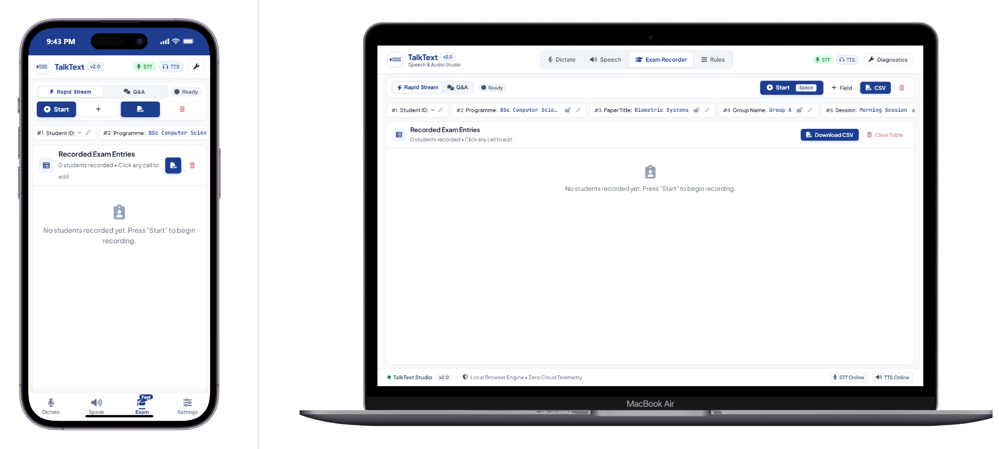

# TalkText Studio 🎙️

> **Fast, private, and customizable voice dictation & speech synthesizer.**  
> Dictate continuous data hands-free, set custom voice macro rules, and craft natural-sounding speech with programmable pauses.

🌐 **Live Web Application:** [https://talktext.vectihost.com/](https://talktext.vectihost.com/)

---

## 📱 Preview



*(To update this screenshot, save your screen capture as `docs/screenshots/app-preview.png`)*

---

## ✨ What You Can Do With TalkText

### 1. ⚡ Rapid Stream Dictation
Designed for high-speed voice entry of repetitive or structured records (such as grading, inventory, attendance, and exam batches):
- **Continuous Voice Entry:** Speak items in sequence with natural pauses (e.g. *“1014 [pause] A [pause] 85”*).
- **Default Locks & Auto-Skip:** Lock constant fields (like Course, Class, or Session) so they automatically fill in for every record without needing to dictate them each time.
- **Hands-Free Spacebar Control:** Press `Space` to start or pause dictation instantly without reaching for your mouse.
- **Inline Editing & Card Pause:** Tap any card or slot to edit values on the fly.
- **One-Click Export:** Download your recorded records straight to CSV or copy to clipboard.

### 2. 📝 Smart Speech-to-Text with Voice Rules
Say goodbye to repetitive manual punctuation and misheard jargon:
- **Custom Voice Triggers:** Define custom word replacements and macro expansions (e.g., saying *"full stop"* inputs `.` or saying *"brb"* inputs *"be right back"*).
- **Phonetic Corrections:** Correct commonly misrecognized words (like *"C"* sounding like *"sea"*).
- **Real-Time Audio Waveform:** Visual feedback confirms when your microphone is actively hearing your voice.
- **Word & Character Counters:** Keep track of your transcripts live.

### 3. 🔊 Scriptable Text-to-Speech with Pauses
Synthesize lifelike voiceovers and speech with precision timing:
- **Programmable Micro-Pauses:** Insert `(rpause)` (~450ms breath pause) or `(lpause)` (~1400ms dramatic pause) right inside your text.
- **Pacing & Speed Modulation:** Accelerate or decelerate specific sentences using inline tags like `(speed:1.2)`.
- **Pitch & Modulation Controls:** Fine-tune base voice pitch, speed, and volume sliders.
- **Interactive Karaoke Highlighter:** Visual sequence tracker lights up words and pause tokens in real time as they are spoken.
- **Saved Script Presets:** Store your favorite voice scripts and reload them anytime.

---

## 🔒 100% Privacy & Offline-Friendly

- **Zero Cloud Recording:** Voice recognition and synthesis happen locally in your web browser.
- **No Account Required:** No signup, no passwords, and zero tracking cookies.
- **Local Storage:** All your custom rules, presets, and recorded data stay on your personal device.

---

## 📲 Install as an App (PWA)

TalkText is a Progressive Web App that works seamlessly across smartphones, tablets, and desktop computers:
- **On Mobile (Android / Chrome):** Tap the browser menu `⋮` and select **"Install App"** or **"Add to Home Screen"**.
- **On iPhone (iOS / Safari):** Tap the Share button `⎋` and choose **"Add to Home Screen"**.
- **On Desktop (Chrome / Edge):** Click the install icon in the address bar to install TalkText as a standalone desktop app.

---

## 🚀 Quick Start (Local Setup)

If you wish to run TalkText locally on your own computer:

```bash
# Clone the repository
git clone https://github.com/kwasihenri/TalkText.git

# Navigate to project folder
cd TalkText/TalkText

# Install dependencies
npm install

# Build for production
npm run build
```

---

## 📄 License

Open-source under the [MIT License](LICENSE).
